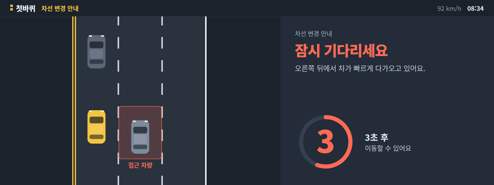
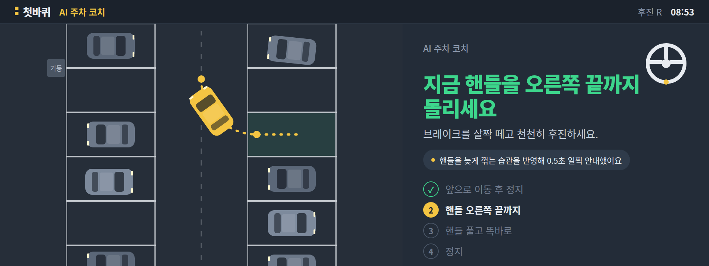
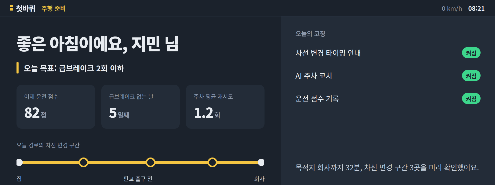
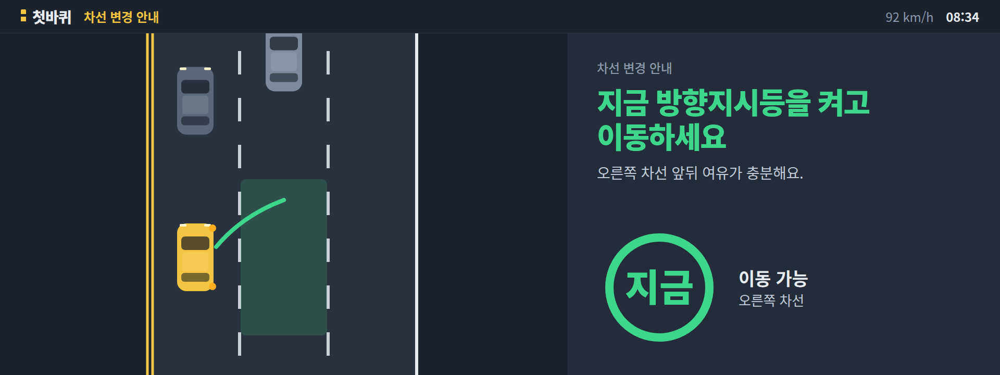
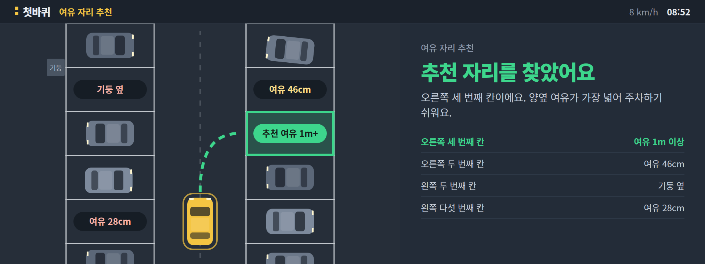
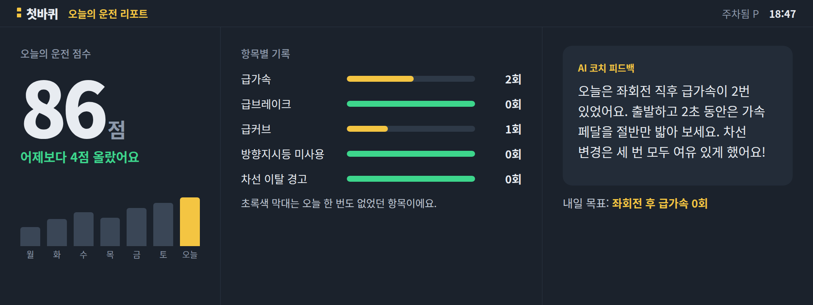
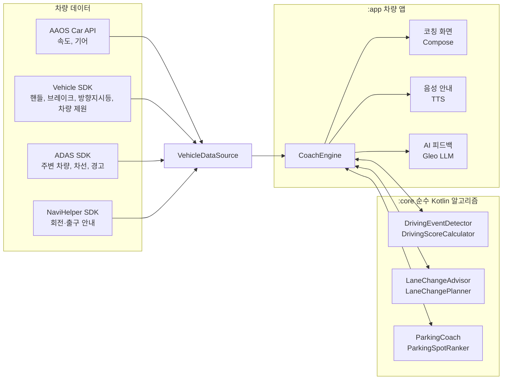

# 첫바퀴 (FirstWheel)

## 앱 이름 및 한 줄 소개

**첫바퀴** — 주차부터 차선 변경, 운전 습관까지 차량 센서 데이터로 실시간 코칭해 주는, 초보 운전자 옆자리의 AI 운전 강사 앱 (Pleos Connect 기반 차량용 인포테인먼트 앱)

<p align="center">
  
  
</p>

## APK 파일 위치

- [`apk/공파리_첫바퀴_release.apk`](apk/공파리_첫바퀴_release.apk)
<!-- APK를 GitHub Releases에 올렸다면 아래 줄을 Release 페이지 주소로 바꾸기 -->
- GitHub Release: 해당 없음 (저장소 `apk/` 폴더에 포함)

## 실행 방법

### APK로 바로 실행하기

1. Android Studio의 Device Manager에서 **Pleos Connect Emulator**(또는 Android Automotive 에뮬레이터)를 실행합니다.
2. 저장소를 내려받은 폴더에서 APK를 설치합니다.
   ```bash
   adb install -r apk/공파리_첫바퀴_release.apk
   ```
3. 에뮬레이터 앱 목록에서 **첫바퀴**를 실행합니다.
4. 앱은 **시연 모드**로 시작합니다. 가상 주행 데이터로 고속도로 출구 앞 차선 변경 장면이 약 22초 동안 재생되고 계속 반복됩니다.
   - 약 2~6초: 출구 앞 차선 변경 준비 안내, 오른쪽 뒤차가 다가와 "잠시 기다리세요"와 카운트다운
   - 약 6초: 뒤차가 지나가면 "지금 방향지시등을 켜고 이동하세요"
   - 9초, 13초: 차선을 한 칸씩 옮긴 뒤 출구 차선 진입, "안전 운전 중이에요"로 복귀
5. 음성 안내를 들으려면 에뮬레이터의 시스템 설정에서 한국어 TTS 음성이 설치되어 있어야 합니다. 없어도 화면 안내는 정상 동작합니다.

### 소스에서 빌드하기

```bash
# 알고리즘 단위 테스트 (차량·에뮬레이터 없이 PC에서 실행)
gradle :core:test

# release APK 빌드 → app/build/outputs/apk/release/공파리_첫바퀴_release.apk
gradle :app:assembleRelease
```

Android Studio에서 열 때는 프로젝트 폴더를 그대로 열면 `gradle/wrapper/gradle-wrapper.properties`에 지정된 Gradle 8.7을 자동으로 받습니다. GitHub Actions의 **build-release-apk** 워크플로를 실행해도 같은 APK를 내려받을 수 있습니다.

## 테스트 환경 및 필요한 설정

<!-- 실제로 테스트한 에뮬레이터 이미지·버전으로 확인 후 수정 -->
| 항목 | 내용 |
|---|---|
| 실행 기기 | Pleos Connect Emulator (Android Automotive OS 기반 AVD) |
| 최소 Android 버전 | Android 10 (API 29) 이상 |
| 화면 | 가로형 차량 중앙 디스플레이 |
| 개발 도구 | Android Studio, JDK 17, Gradle 8.7, Android Gradle Plugin 8.5.2, Kotlin 1.9.24 |
| 필요한 설정 | 시연 모드는 별도 설정 없이 실행됩니다. 음성 안내는 한국어 TTS 음성이 필요합니다. |
| 실차 데이터 모드 | `app/src/main/kotlin/ai/firstwheel/app/ui/MainActivity.kt`의 `USE_SIMULATION`을 `false`로 바꾸면 AAOS Car API(속도·기어)를 사용합니다. 이때 차량 속성 권한(`CAR_SPEED`, `CAR_POWERTRAIN`) 허용이 필요하고, 핸들·브레이크·ADAS 데이터는 Pleos Connect SDK 연동 후 사용할 수 있습니다. |
| 서명 | 저장소 루트에 `keystore.properties`(storeFile, storePassword, keyAlias, keyPassword)가 있으면 그 키로, 없으면 디버그 키로 서명합니다. |

## 시연 영상

[콘셉트 시연 영상 보기 (75초)](docs/media/firstwheel_concept_demo.mp4)

주행 준비 → 차선 변경 타이밍 안내 → 여유 자리 추천 → AI 주차 코치 → 오늘의 운전 리포트 순서로, 면허를 딴 지 3개월 된 운전자의 하루를 따라갑니다.

## 주요 기능

| 기능 | 하는 일 | 사용하는 차량 데이터 |
|---|---|---|
| AI 주차 코치 | 후진 주차를 4단계로 나눠 "지금 핸들을 오른쪽 끝까지"처럼 시점을 안내합니다. 핸들을 늦게 꺾는 습관이 있으면 안내를 그만큼 일찍 합니다. | 핸들 각도, 속도, 기어, 후방 거리, 차량 제원 |
| 여유 자리 추천 | 빈 주차면마다 양옆 여유를 계산해 가장 넉넉한 자리를 먼저 추천합니다. 기둥 옆이나 먼 자리는 감점합니다. | ADAS 객체 인식, 차량 전폭·전장 |
| 차선 변경 타이밍 | 경로상 출구·회전 지점을 미리 보고, 목표 차선의 앞뒤 차 위치와 속도로 안전한 틈이 생기는 시점을 초 단위로 예측해 카운트다운합니다. | ADAS 주변 차량·차선 정보, 내비게이션 경로, 방향지시등 |
| 오늘의 운전 점수 | 급가속, 급브레이크, 급커브, 방향지시등 미사용, 차선 이탈·근접 경고를 채점하고 AI가 맞춤 피드백을 줍니다. | 속도, 핸들 각도, 브레이크, 방향지시등, ADAS 경고 |

### 화면 시안

| 주행 준비 | 차선 변경 대기 | 차선 변경 이동 |
|---|---|---|
|  |  |  |
| **여유 자리 추천** | **AI 주차 코치** | **오늘의 운전 리포트** |
|  |  |  |

## 왜 차량 앱인가

스마트폰 앱은 GPS와 가속도 센서로 운전 상황을 추정할 수밖에 없습니다. 첫바퀴는 차량이 직접 측정한 핸들 각도와 브레이크 페달 상태, ADAS가 인식한 주변 차량을 사용하므로 "지금 핸들을 꺾으세요", "3초 뒤 이동 가능" 같은 정밀한 안내가 가능합니다.

## 아키텍처



판단 로직은 차량 SDK에 의존하지 않는 `:core` 모듈에 모았습니다. 그래서 차량이나 에뮬레이터 없이 PC에서 단위 테스트로 검증할 수 있고, SDK 버전이 바뀌어도 데이터 연결 부분만 고치면 됩니다. 자세한 설계는 [docs/ARCHITECTURE.md](docs/ARCHITECTURE.md), 알고리즘은 [docs/ALGORITHMS.md](docs/ALGORITHMS.md)에 정리했습니다.

### 사용하는 Pleos Connect SDK / API

| SDK | API | 용도 |
|---|---|---|
| AAOS Car API | PERF_VEHICLE_SPEED, GEAR_SELECTION | 속도 변화율(급가속·급감속), 후진 기어 진입 시 주차 코치 시작 |
| Vehicle SDK | Steeringwheel, Brake, TurnSignal, CarInfo, Safety | 주차 단계 판정, 급커브·급브레이크, 방향지시등 미사용 감지, 차량 크기 |
| ADAS SDK | Tracked Object, Local Map, Warning, AutoParking | 차선 변경 틈 예측, 차선 변경 감지, 경고 반영, 빈 주차면 판단 |
| NaviHelper SDK | 경로 안내 정보 | 차선 변경이 필요한 구간 미리 계산 |
| Fused Location SDK | 차량 위치 | 주차장 진입 판단, 구간별 기록 |
| Gleo AI SDK | TextToSpeech, SpeechToText, LLM | 음성 코칭, 음성 명령, 맞춤 피드백 문장 |
| Sync SDK | SyncDocument | 운전 리포트를 스마트폰 앱과 동기화 |

## 프로젝트 구조

```
firstwheel/
├─ core/                         # 순수 Kotlin 알고리즘 모듈 (SDK 의존 없음)
│  └─ src/main/kotlin/ai/firstwheel/core/
│     ├─ model/                  # 차량 신호, 주변 차량, 차량 제원
│     ├─ scoring/                # 위험 운전 이벤트 감지, 하루 점수, 피드백 문장
│     ├─ lanechange/             # 차선 변경 틈 예측, 준비 시점 판단
│     └─ parking/                # 주차 코치 상태 머신, 습관 학습, 주차면 추천
│  └─ src/test/                  # 단위 테스트
├─ apk/                          # 제출용 release APK
├─ app/                          # Android Automotive 앱
│  └─ src/main/kotlin/ai/firstwheel/app/
│     ├─ data/                   # AAOS·Pleos SDK 연결, 시연용 가상 주행 데이터
│     ├─ coach/                  # CoachEngine: 데이터 → 알고리즘 → 화면·음성
│     ├─ voice/                  # TTS, LLM 피드백 생성기
│     └─ ui/                     # Compose 코칭 화면
└─ docs/                         # 설계 문서, 화면 시안, 시연 영상
```

## Pleos Connect SDK 연동 방법 (개발자용)

1. `settings.gradle.kts`와 `app/build.gradle.kts`의 TODO 위치에 Pleos Connect SDK 저장소와 의존성을 추가합니다.
2. `PleosVehicleDataSource`의 TODO에 Vehicle·ADAS·NaviHelper SDK 호출을 채웁니다.
3. `USE_SIMULATION = false`로 바꿔 실제 차량 데이터로 실행합니다.

## 개발 현황

- [x] 핵심 알고리즘: 운전 이벤트 감지와 점수, 차선 변경 틈 예측, 주차 코치 상태 머신과 습관 학습, 주차면 추천
- [x] 알고리즘 단위 테스트
- [x] 앱 골격: 데이터 소스 인터페이스, AAOS 속도·기어 연동, 코칭 엔진, 기본 코칭 화면, 음성 안내
- [x] 시연용 가상 주행 데이터 (차선 변경 시나리오, 반복 재생)
- [x] release APK 빌드 설정과 GitHub Actions 자동 빌드
- [x] 화면 시안, 콘셉트 시연 영상
- [ ] Pleos Connect Vehicle SDK 연동 (핸들, 브레이크, 방향지시등)
- [ ] ADAS SDK 연동 (주변 차량, 차선, 경고) — 차종별 지원 여부 확인 필요
- [ ] 도로·주차장 탑뷰 시각화 (시안 수준)
- [ ] Gleo AI TTS·LLM 연동, Sync SDK 리포트 동기화

## 안전과 개인정보 원칙

- 첫바퀴는 차량을 **직접 제어하지 않는 안내 앱**입니다. 최종 판단과 조작은 운전자가 합니다.
- 주행 중에는 음성 안내를 중심으로 동작하고, 화면에는 큰 글씨 한 줄과 짧은 보조 문장만 보여 줍니다 (Driver Distraction 가이드 준수).
- 개인화 학습(주차 습관 등)은 차량 안에서 처리하고, 리포트 동기화는 사용자 동의 후에만 진행합니다.
- 경고 판단 기준값은 설정으로 분리해 공신력 있는 기준과 실제 주행 데이터로 조정할 수 있게 했습니다.

## 라이선스

[MIT License](LICENSE)
