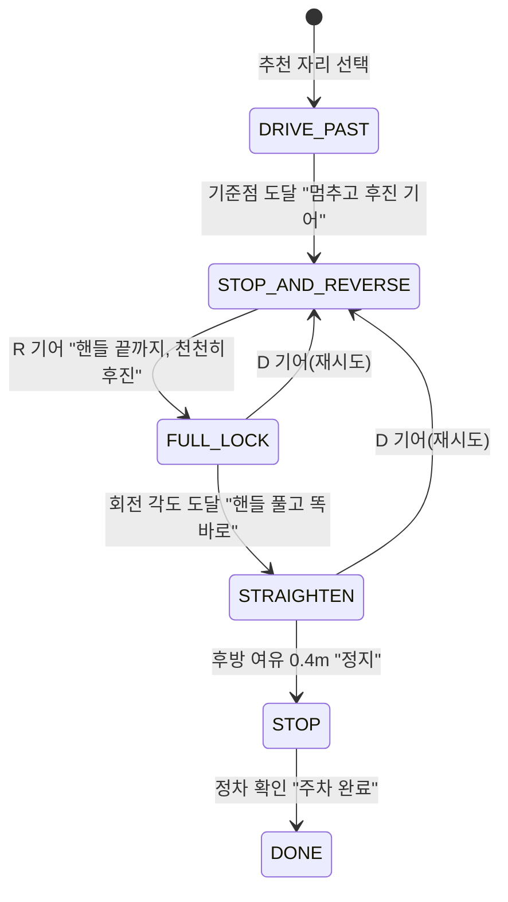

# 알고리즘 설명

모든 기준값은 코드에서 설정 객체(`DetectionThresholds`, `LaneChangeParams`, `ParkingParams`)로 분리했습니다. 아래 숫자는 시작값이며, 한국교통안전공단 위험운전행동 기준 같은 공신력 있는 기준과 실제 주행 데이터로 조정할 예정입니다.

## 1. 오늘의 운전 점수

### 이벤트 감지 (`DrivingEventDetector`)

| 이벤트 | 판단 방법 | 시작값 |
|---|---|---|
| 급가속 | 연속된 두 샘플의 속도 변화율 | 3.0 m/s² 이상 |
| 급브레이크 | 속도 변화율 | -3.5 m/s² 이하 |
| 급커브 | 핸들 각도로 추정한 횡가속도 | 시속 20km 이상에서 3.5 m/s² 이상 |
| 방향지시등 미사용 | 차선 변경 감지 시점 기준 3초 안에 방향지시등이 켜진 적 없음 | 3초 |
| 차선 이탈·충돌·근접 경고 | ADAS Warning API 이벤트 | 그대로 반영 |

급커브의 횡가속도는 자전거 모델로 추정합니다.

```
바퀴 조향각 δ = 핸들 각도 / 조향비
횡가속도 a = v² · tan(δ) / 축간거리
```

같은 종류의 이벤트는 2초 안에 다시 세지 않아, 한 번의 급제동이 여러 번 감점되지 않게 했습니다.

### 점수 계산 (`DrivingScoreCalculator`)

100점에서 이벤트마다 감점합니다. 한 항목이 점수를 지나치게 깎지 않도록 항목별 감점 상한(20점)을 둡니다.

| 항목 | 1회 감점 |
|---|---|
| 충돌 경고 | 6 |
| 방향지시등 미사용 | 5 |
| 급브레이크 | 4 |
| 급가속, 급커브, 차선 이탈 경고 | 3 |
| 근접 경고 | 2 |

### 피드백 (`FeedbackWriter`)

리포트를 LLM 프롬프트로 바꿔 Gleo AI LLM SDK에 보내고, "칭찬 한 가지 + 구체적인 개선 방법 한 가지"를 세 문장 이내로 받습니다. LLM을 쓸 수 없을 때는 감점이 가장 큰 항목에 맞춘 규칙 기반 문장을 사용합니다.

## 2. 차선 변경 타이밍 (`LaneChangeAdvisor`)

### 입력

ADAS Tracked Object 정보를 내 차 기준으로 바꾼 목표 차선의 차량 목록입니다. 차량마다 앞뒤 거리(앞 +, 뒤 −)와 상대 속도(상대 차 속도 − 내 차 속도)를 씁니다.

### 안전 조건

범퍼 사이 간격이 필요 간격 이상이어야 합니다.

```
뒤차: 간격 ≥ 최소 간격(6m) + max(0, 뒤차가 다가오는 속도) × 2.5초
앞차: 간격 ≥ 최소 간격(6m) + max(0, 내가 앞차에 다가가는 속도) × 1.5초
```

### 시점 예측

1. 모든 차량이 현재 상대 속도를 유지한다고 보고 0.1초 단위로 8초 뒤까지 위치를 계산합니다.
2. 각 시점마다 안전 조건을 확인합니다.
3. 안전 상태가 **1초 이상 연속으로 유지되는** 가장 이른 시점을 찾습니다. 순간적으로만 비는 틈을 안내하지 않기 위해서입니다.
4. 그 시점이 0초면 "지금 이동", 8초 안이면 "N초 후 이동"(카운트다운), 없으면 "지금은 어려움"으로 안내합니다.

**예시**: 오른쪽 차선 10m 뒤에서 차가 초속 5m 빠르게 다가오면, 그 차가 앞으로 지나가 충분히 멀어지는 약 4.2초 뒤를 이동 시점으로 예측하고 5초 카운트다운을 보여 줍니다.

### 준비 시점 (`LaneChangePlanner`)

내비게이션의 회전·출구 지점까지 남은 시간이 `이동할 차선 수 × 15초 + 15초` 이하가 되면 준비 안내를 시작합니다. 시속 90km로 두 차선을 옮겨야 한다면 약 1.1km 전부터 안내합니다.

## 3. AI 주차 코치 (`ParkingCoach`)

### 단계



### 위치와 각도 추정

차량 신호를 0.1초마다 적분합니다.

```
이동 거리 += 속도 × Δt          (후진이면 음수)
회전 속도  = 속도 × tan(δ) / 축간거리
회전 각도 += 회전 속도 × Δt
```

- **기준점**: 주차면 중심을 `최소 회전 반경 − 0.5m`만큼 지났을 때 멈추면, 핸들을 끝까지 돌린 채 후진해 한 번에 들어갈 수 있습니다.
- **핸들 풀기 시점**: 차가 90°를 다 돌기 전에 미리 안내해야 운전자가 핸들을 푸는 동안 차가 마저 돌아 주차선과 나란해집니다. 기본 10° 전에 안내합니다.

### 습관 학습 (`ParkingHabit`)

"핸들 끝까지" 안내 후 실제로 핸들을 최대 조향의 80% 이상 돌리기까지 걸린 시간을 반응 시간으로 측정합니다. 첫 측정값을 그대로 쓰고, 이후에는 지수이동평균(가중치 0.3)으로 갱신합니다.

학습된 반응 시간만큼 모든 안내를 앞당깁니다.

```
멈춤 안내 거리     = 기준점 − 속도 × 반응 시간
핸들 풀기 안내 각도 = 90° − (10° + 회전 속도 × 반응 시간)
정지 안내 거리     = 0.4m + 속도 × 반응 시간
```

반응 시간이 1초인 운전자에게는 핸들 풀기 안내가 약 7° 일찍 나옵니다(단위 테스트로 확인).

## 4. 여유 자리 추천 (`ParkingSpotRanker`)

```
기본 여유     = (주차면 폭 − 내 차 폭) / 2
한쪽 여유     = 기본 여유 − 옆 차가 넘어온 거리 + (옆 칸이 비었으면 1m)
쓸 수 있는 여유 = (왼쪽 여유 + 오른쪽 여유) / 2      ← 넓은 쪽으로 붙여 세울 수 있으므로
점수          = 쓸 수 있는 여유 × 100 − 기둥 옆 30 − 거리(m) × 0.5
```

쓸 수 있는 여유가 0.2m보다 작거나 주차면 길이가 내 차보다 0.3m 이상 길지 않은 자리는 추천에서 뺍니다.

## 테스트

`core/src/test/kotlin/ai/firstwheel/core/CoreLogicTest.kt`에서 위 동작을 검증합니다.

- 차선 변경: 빈 차선, 다른 차선의 차, 먼 뒤차, 빠르게 다가오는 뒤차(카운트다운 5), 바로 옆 차, 느린 앞차, 준비 시점
- 운전 점수: 급가속, 완만한 가속, 급브레이크 중복 방지, 급커브, 방향지시등 미사용, 점수·피드백, 감점 상한
- 주차 코치: 단계 순서, 반응 시간 학습, 느린 운전자에게 더 이른 안내, 왼쪽 주차
- 주차면 추천: 순위와 좁은 자리 제외
