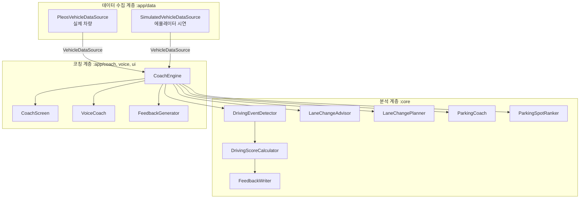
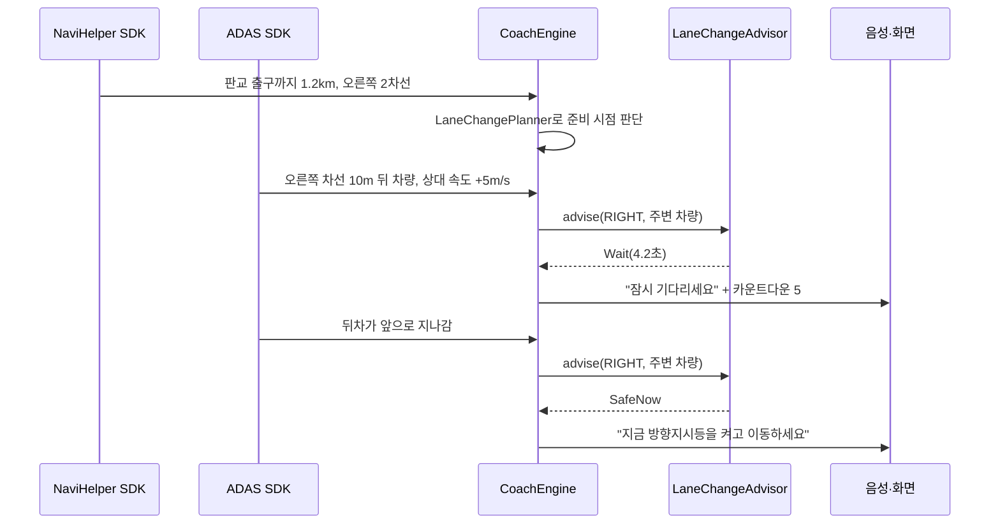

# 설계 문서

## 설계 원칙

1. **판단 로직과 차량 연결을 분리한다.** 운전 점수, 차선 변경, 주차 코치 알고리즘은 `:core` 모듈에 있고 Android나 Pleos SDK를 전혀 참조하지 않습니다. 덕분에 PC에서 단위 테스트로 검증할 수 있고, SDK 버전이 바뀌어도 `:app/data`만 수정하면 됩니다.
2. **지원되지 않는 기능이 있어도 앱은 동작한다.** 지원 API는 차종과 SDK 버전마다 다릅니다. ADAS 데이터가 없으면 주변 차량 목록이 비어 있는 상태로 동작하고, 운전 점수와 주차 코치는 Vehicle SDK만으로 계속 작동합니다.
3. **주행 중에는 귀로, 정차 중에는 눈으로.** 주행 중 안내는 음성이 중심이고 화면은 보조입니다. 상세 리포트는 정차 후나 스마트폰 앱에서 봅니다.
4. **안내만 하고 제어하지 않는다.** 모든 기능은 운전자에게 정보를 주는 역할에 그칩니다.

## 계층 구조

| 계층 | 위치 | 책임 |
|---|---|---|
| 데이터 수집 | `app/data` | 여러 SDK에서 따로 들어오는 값을 10Hz `VehicleSample`과 주변 차량 목록으로 정리 |
| 분석 | `core` | 이벤트 감지, 점수 계산, 차선 변경 시점 예측, 주차 단계 판정, 습관 학습, 주차면 순위 |
| 코칭 | `app/coach`, `app/voice`, `app/ui` | 분석 결과를 화면 상태와 음성 문장으로 바꾸고, 같은 문장을 반복해 읽지 않도록 관리 |

## 데이터 흐름 예시: 차선 변경

## SDK 연동 계획

| 앱 입력 | SDK / API | 구현 위치 | 상태 |
|---|---|---|---|
| 속도, 기어 | AAOS Car API `CarPropertyManager` | `CarPropertyReader` | 구현 |
| 핸들 각도 | Vehicle SDK Steeringwheel API | `PleosVehicleDataSource` | TODO |
| 브레이크 페달 | Vehicle SDK Brake API | `PleosVehicleDataSource` | TODO |
| 방향지시등 | Vehicle SDK TurnSignal API | `PleosVehicleDataSource` | TODO |
| 차량 크기 | Vehicle SDK CarInfo API | `CarProfile` 생성 | TODO |
| 주변 차량 | ADAS SDK Tracked Object API | `PleosVehicleDataSource` | TODO |
| 차선 변경 감지 | ADAS SDK Local Map API | `PleosVehicleDataSource` | TODO |
| 경고 | ADAS SDK Warning API | `PleosVehicleDataSource` | TODO |
| 회전·출구 안내 | NaviHelper SDK | `PleosVehicleDataSource` | TODO |
| 음성 안내 | Gleo AI TextToSpeech (현재는 Android TTS) | `VoiceCoach` | 대체 구현 |
| AI 피드백 | Gleo AI LLM (현재는 규칙 기반 문장) | `FeedbackGenerator` | 대체 구현 |
| 리포트 동기화 | Sync SDK | 예정 | TODO |

권한은 Pleos App Market과 협의·승인된 범위만 선언합니다.

## 개인정보

- 주행 기록과 주차 습관은 기본적으로 차량 안에만 저장합니다.
- 스마트폰 리포트 동기화와 익명 통계 활용은 사용자가 동의했을 때만 진행합니다.
- 위치 정보는 주차장 진입 판단과 구간 기록에만 쓰고, 리포트에는 구간 이름 수준으로만 남깁니다.
